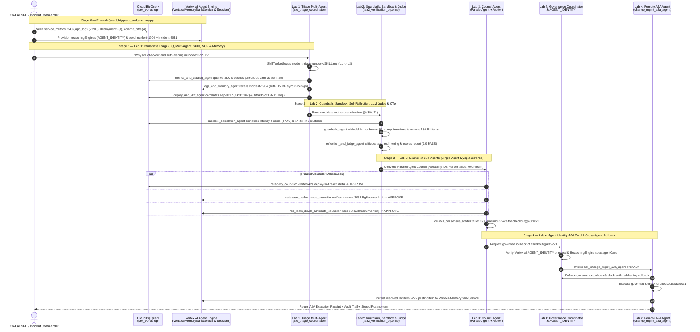

# SRE Guardian (`Incident-2277`) — End-to-End Vertex AI & ADK Architecture

This document provides the end-to-end system, data-flow, and sequence
architecture for the **SRE Guardian (`Incident-2277`)** workshop running on
**Google Cloud BigQuery (`$GOOGLE_CLOUD_PROJECT.sre_workshop`)**, **Vertex AI
Agent Engine (`projects/$GOOGLE_CLOUD_PROJECT/locations/us-central1/reasoningEngines/$VERTEX_AGENT_ENGINE_ID`)**,
and **Google Cloud Model Armor (`sre-guardian-armor-policy`)**.

---

## 1. End-to-End Multi-Agent & Vertex AI Platform Architecture

```mermaid
flowchart TB
    %% Styling
    classDef gcp fill:#E8F0FE,stroke:#1A73E8,stroke-width:2px,color:#0D47A1
    classDef vertex fill:#FCE8E6,stroke:#D93025,stroke-width:2px,color:#A50E0E
    classDef adkPro fill:#E6F4EA,stroke:#1E8E3E,stroke-width:2px,color:#0D652D
    classDef adkFlash fill:#FEF7E0,stroke:#F9AB00,stroke-width:2px,color:#B06000
    classDef security fill:#F3E8FD,stroke:#9334E6,stroke-width:2px,color:#4A148C

    %% =========================================================================
    %% PREWORK: DATA & MEMORY SEEDING
    %% =========================================================================
    subgraph Prework["0. Prework: Cloud Data & Vertex AI Agent Engine Seeding (us-central1)"]
        direction LR
        subgraph BQ["Google Cloud BigQuery (sre_workshop)"]
            BQ_Metrics["service_metrics<br/>(240 rows: p99 & HTTP 500s)"]:::gcp
            BQ_Logs["app_logs<br/>(7,200 rows + 60 Injections + 180 PII)"]:::gcp
            BQ_Deploys["deployments<br/>(4 rows: dep-9014..dep-9017)"]:::gcp
            BQ_Diffs["commit_diffs<br/>(4 git diffs: sha a3f9c21)"]:::gcp
        end
        Catalog["Knowledge Catalog Context<br/>(Tier-0 SLOs, $18.5k/min GMV)"]:::gcp
        BQToolset["ADK BigQueryToolset<br/>(WriteMode.BLOCKED + Parameterized SQL)"]:::gcp

        subgraph AgentEngine["Vertex AI Agent Engine (identityType: AGENT_IDENTITY)"]
            VertexMem["VertexAiMemoryBankService<br/>(Long-Term Memory: Incident-1904 & Incident-2051)"]:::vertex
            VertexSess["VertexAiSessionService<br/>(Stateful ADK Invocation Sessions)"]:::vertex
            VertexSandbox["AgentEngineSandboxCodeExecutor<br/>(Isolated Python Execution Sandbox)"]:::vertex
        end

        SkillReg["EnterpriseSkillRegistry (ADK SkillRegistry)<br/>+ SkillToolset (L1->L2 Progressive Disclosure)<br/>- incident-triage-runbook (v2.1.0)<br/>- governed-rollback-playbook (v1.4.0)"]:::vertex
    end

    %% =========================================================================
    %% LAB 1: IMMEDIATE TRIAGE MULTI-AGENT SYSTEM
    %% =========================================================================
    subgraph Lab1["1. Lab 1: Immediate Triage Multi-Agent System (lab1_triage_agent)"]
        direction TB
        L1_Coord["sre_triage_coordinator<br/>(ADK LlmAgent — gemini-2.5-pro)"]:::adkPro
        L1_Metrics["metrics_and_catalog_agent<br/>(ADK LlmAgent — gemini-2.5-flash)"]:::adkFlash
        L1_Logs["logs_and_memory_agent<br/>(ADK LlmAgent — gemini-2.5-flash)"]:::adkFlash
        L1_Deploys["deploy_and_diff_agent<br/>(ADK LlmAgent — gemini-2.5-flash)"]:::adkFlash

        L1_Coord -->|"call_metrics_and_catalog_agent"| L1_Metrics
        L1_Coord -->|"call_logs_and_memory_agent"| L1_Logs
        L1_Coord -->|"call_deploy_and_diff_agent"| L1_Deploys
    end

    %% =========================================================================
    %% LAB 2: GUARDRAILS, SELF-REFLECTION, JUDGE, OTEL & SANDBOX
    %% =========================================================================
    subgraph Lab2["2. Lab 2: Guardrails, Self-Reflection, Vertex AI Judge & Sandbox (lab2_guardrails_reflection_sandbox)"]
        direction LR
        L2_Seq["lab2_verification_pipeline<br/>(ADK SequentialAgent)"]:::adkPro
        L2_Sandbox["sandbox_correlation_agent<br/>(z-score = 47.46, 14.2x N+1)"]:::adkFlash
        L2_Guard["guardrails_agent + ModelArmorInspector<br/>(before_model & before_tool callbacks:<br/>60 injections blocked, 180 PII redacted)"]:::security
        L2_Reflect["reflection_and_judge_agent<br/>(Self-Reflection + Vertex AI GenAI Judge:<br/>Rejects auth red herring, Score = 1.0 PASS)"]:::adkPro
        OTel["ObservabilityTracker<br/>(OpenTelemetry Trace Spans)"]:::security

        L2_Seq --> L2_Sandbox --> L2_Guard --> L2_Reflect
        L2_Sandbox -.->|"Agent/Model/Tool Callbacks"| OTel
        L2_Guard -.->|"Agent/Model/Tool Callbacks"| OTel
        L2_Reflect -.->|"Agent/Model/Tool Callbacks"| OTel
    end

    %% =========================================================================
    %% LAB 3: COUNCIL OF SUB-AGENTS (SINGLE-AGENT MYOPIA DEFENSE)
    %% =========================================================================
    subgraph Lab3["3. Lab 3: Council of Sub-Agents (lab3_council_agent)"]
        direction TB
        L3_Par["parallel_council_deliberation<br/>(ADK ParallelAgent)"]:::adkPro
        C_Rel["reliability_councilor<br/>(gemini-2.5-flash)<br/>28m SLO breach vs 90s auth blip"]:::adkFlash
        C_DB["database_performance_councilor<br/>(gemini-2.5-flash)<br/>100-conn PgBouncer pool + N+1 diff"]:::adkFlash
        C_Red["red_team_devils_advocate_councilor<br/>(gemini-2.5-flash)<br/>Counterfactuals & injection trap check"]:::adkFlash
        L3_Arb["council_consensus_arbiter<br/>(ADK LlmAgent — gemini-2.5-pro)<br/>3/3 Unanimous Vote: checkout@a3f9c21"]:::adkPro

        L3_Par --> C_Rel & C_DB & C_Red
        C_Rel & C_DB & C_Red --> L3_Arb
    end

    %% =========================================================================
    %% LAB 4: GOVERNANCE, AGENT IDENTITY, MODEL ARMOR & A2A ROLLBACK
    %% =========================================================================
    subgraph Lab4["4. Lab 4: Agent Identity (AGENT_IDENTITY), Model Armor, A2A Card & Rollback (lab4_governance_and_a2a)"]
        direction LR
        L4_Coord["sre_governance_coordinator<br/>(ADK LlmAgent — gemini-2.5-pro)"]:::adkPro
        Gateway["AgentGatewayEnforcer + AGENT_IDENTITY<br/>- First-Class IAM Principal<br/>- ReasoningEngine.spec.agentCard<br/>- Model Armor Policy (sre-guardian-armor-policy)"]:::security
        SCC["Security Audit & Threat Findings:<br/>- HIGH: Blocked auth rollback<br/>- MEDIUM: Unauthorized caller attempt"]:::security
        L4_A2A["change_mgmt_a2a_agent<br/>(Remote A2A Agent — gemini-2.5-flash)<br/>Executes rollback checkout@a3f9c21"]:::adkFlash

        L4_Coord -->|"call_change_mgmt_a2a_agent (A2A)"| Gateway
        Gateway -->|"Authorized Identity + 3/3 Council"| L4_A2A
        Gateway -.->|"Policy Violation"| SCC
    end

    %% Cross-Stage Connections
    BQ --> BQToolset
    BQToolset --> L1_Metrics & L1_Logs & L1_Deploys
    Catalog --> L1_Metrics
    SkillReg -->|"load_skill(incident-triage-runbook)"| L1_Coord
    VertexMem <-->|"Recall Incident-1904 & Incident-2051"| L1_Logs
    VertexSess <--> Lab1 & Lab2 & Lab3 & Lab4

    Lab1 -->|"Candidate Hypothesis"| Lab2
    VertexSandbox --> L2_Sandbox
    Lab2 -->|"Verified Evidence + Sanitized Context"| Lab3
    BQToolset --> C_Rel & C_DB & C_Red
    VertexMem --> C_DB & C_Red

    Lab3 -->|"3/3 Consensus Verdict"| Lab4
    SkillReg -->|"load_skill(governed-rollback-playbook)"| L4_Coord
    L4_A2A ==>|"Persist Resolved Postmortem (Incident-2277)"| VertexMem
```

---

## 2. Cross-Lab Execution & Governance Sequence Diagram

---

## 3. Vertex AI & Google Cloud Resource Mapping

| Workshop Component | Google Cloud / Vertex AI Resource | Implementation in Code |
| :--- | :--- | :--- |
| **Cloud Data Warehouse (BYOD)** | Google Cloud BigQuery (`$GOOGLE_CLOUD_PROJECT.sre_workshop`) | [`BigQueryMcpClient`](provided.py) (`service_metrics`, `app_logs`, `deployments`, `commit_diffs`) + ADK [`BigQueryToolset`](provided.py) (`WriteMode.BLOCKED`) |
| **Business & SLO Metadata** | Dataplex Knowledge Catalog Context | [`KNOWLEDGE_CATALOG_CONTEXT`](provided.py) (`Tier-0` SLOs, PgBouncer architecture, GMV impact) |
| **Agent Engine Runtime & Identity** | Vertex AI Agent Engine (`identityType: AGENT_IDENTITY`) | [`ensure_vertex_agent_engine`](provided.py) via `vertexai.Client.agent_engines` |
| **Long-Term Memory Bank** | Vertex AI Agent Engine Memory Bank (`VertexAiMemoryBankService`) | [`AgentMemoryBank.create_memory_service()`](provided.py) + `seed_adk_memory_service()` (`Incident-1904`, `Incident-2051`, `Incident-2277`) |
| **Short-Term Session State** | Vertex AI Agent Engine Sessions (`VertexAiSessionService`) | [`AgentMemoryBank.create_session_service()`](provided.py) |
| **Isolated Code Sandbox** | Vertex AI Agent Engine Sandbox (`AgentEngineSandboxCodeExecutor`) | [`create_vertex_sandbox_code_executor()`](provided.py) + [`execute_isolated_sandbox_correlation()`](lab2_guardrails_reflection_sandbox/agent.py) |
| **Models & LLM-as-a-Judge** | Vertex AI Gemini (`gemini-2.5-pro` & `gemini-2.5-flash`) | [`get_adk_model()`](provided.py) + [`evaluate_with_vertex_genai_judge()`](provided.py) (`genai.Client(vertexai=True)`) |
| **Skill Registry & Toolset** | ADK `SkillRegistry` & `SkillToolset` | [`EnterpriseSkillRegistry`](provided.py) (`skills/incident-triage-runbook`, `skills/governed-rollback-playbook`) |
| **Guardrails & Model Armor** | Google Cloud Model Armor (`templates/sre-guardian-armor-policy`) | [`ModelArmorInspector`](provided.py) + [`AgentGatewayEnforcer`](provided.py) |
