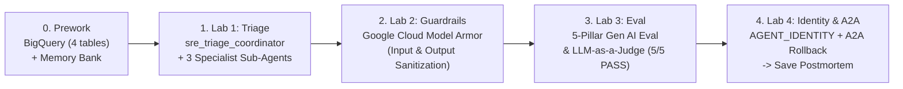
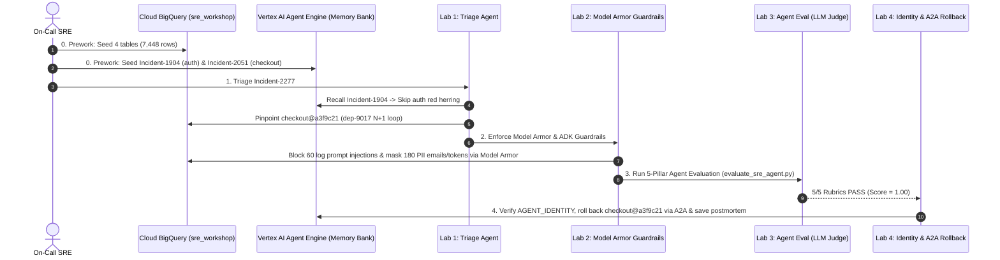

# SRE Guardian (`Incident-2277`) — Architecture Overview

Concise system flow and resource mapping for the 5-step workshop.
([← Back to Workshop README](README.md))

---

## 1. 5-Step Workshop Flow

<b>🔄 Expand Full Sequence Diagram (Steps 0–4)</b>

<b>☁️ Expand Google Cloud & Vertex AI Resource Mapping</b>

| Component | GCP / Vertex AI Resource | Code Reference |
| :--- | :--- | :--- |
| **Data Warehouse** | Cloud BigQuery (`$GOOGLE_CLOUD_PROJECT.sre_workshop`) | [`provided.py`](provided.py) (`BigQueryMcpClient`, `BigQueryToolset`) |
| **Agent Runtime & Identity** | Vertex AI Agent Engine (`identityType: AGENT_IDENTITY`) | [`provided.py`](provided.py) (`ensure_vertex_agent_engine`) |
| **Long-Term Memory** | Vertex AI Memory Bank (`VertexAiMemoryBankService`) | [`prework/seed_bigquery_and_memory.py`](prework/seed_bigquery_and_memory.py) |
| **Prompt & PII Guardrails** | Google Cloud Model Armor (`sre-guardian-armor-policy`) | [`lab2_guardrails_reflection_sandbox/agent.py`](lab2_guardrails_reflection_sandbox/agent.py), [`chat_ux.py`](chat_ux.py) & [`provided.py`](provided.py) |
| **Agent Evaluation (`Eval`)** | Vertex AI Gen AI Eval & LLM-as-a-Judge (`5/5` Rubrics) | [`evals/evaluate_sre_agent.py`](evals/evaluate_sre_agent.py) |
| **A2A & Governance** | `ReasoningEngine.spec.agentCard` & `AgentGatewayEnforcer` | [`lab4_governance_and_a2a/agent.py`](lab4_governance_and_a2a/agent.py) |

