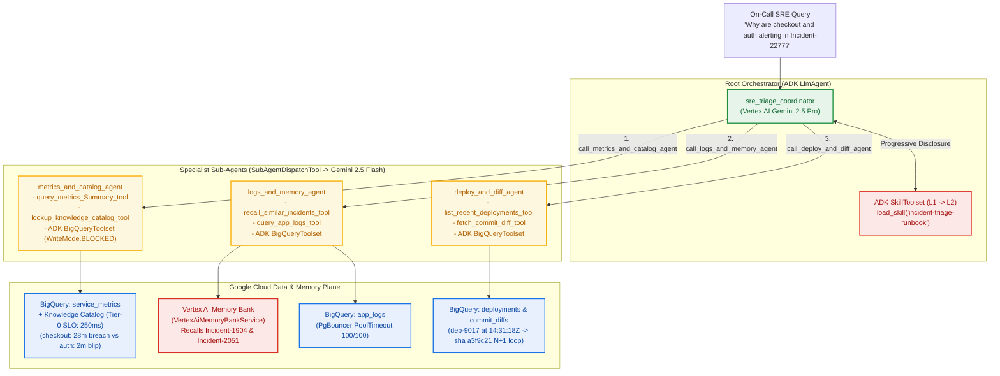

# Lab 1: Immediate Incident Triage Agent (Cloud BigQuery, Multi-Agent, Skills, MCP & Vertex AI Memory Bank)

## Lab 1 Architecture



## Objective

Build a functional **Vertex AI & ADK Multi-Agent Triage System** that answers
real-time incident triage questions for **`Incident-2277`** by combining:

1.  **Bring Your Own Data (Google Cloud BigQuery + Knowledge Catalog)**: Queries
    `$GOOGLE_CLOUD_PROJECT.sre_workshop.service_metrics`, `app_logs`,
    `deployments`, and `commit_diffs` via parameterized `google.cloud.bigquery`
    SQL and ADK's native `BigQueryToolset` (`WriteMode.BLOCKED`), enriched with
    Tier-0 SLO metadata (`KNOWLEDGE_CATALOG_CONTEXT`).
2.  **Multiple Agents (`LlmAgent` hierarchy on Vertex AI Gemini)**:
    -   `sre_triage_coordinator` (`gemini-2.5-pro`): Root orchestrator that
        loads the triage runbook skill and delegates to 3 domain specialists.
    -   `metrics_and_catalog_agent` (`gemini-2.5-flash`): Compares SLO breaches
        across `checkout`, `auth`, `cart`, and `inventory`.
    -   `logs_and_memory_agent` (`gemini-2.5-flash`): Cross-checks Vertex AI
        Agent Engine Long-Term Memory (`Incident-1904` & `Incident-2051`) before
        inspecting `app_logs`.
    -   `deploy_and_diff_agent` (`gemini-2.5-flash`): Correlates recent
        deployments (`dep-9017`) and inspects git commit diffs (`a3f9c21`).
3.  **Skills (`SkillToolset`)**: Dynamically loads
    `skills/incident-triage-runbook/SKILL.md` via ADK's native `SkillToolset`
    (`list_skills`, `load_skill`).
4.  **MCP & BigQuery Toolset (`BigQueryMcpClient`)**: Executes parameterized,
    allow-listed queries against Cloud BigQuery tables.
5.  **Vertex AI Agent Engine Long-Term Memory (`VertexAiMemoryBankService` &
    `VertexAiSessionService`)**: Recalls from Vertex AI Agent Engine Memory Bank
    that the `14:15 UTC` `auth` spike matches `Incident-1904` (benign hourly
    `:15` partner IdP sync), preventing a catastrophic wrong-service rollback.

## Run Lab 1

```bash
# Run with default Incident-2277 triage query:
python3 lab1_triage_agent/agent_complete.py \
  --project_id="${GOOGLE_CLOUD_PROJECT}" \
  --location=us-central1

# Ask a custom natural-language triage question:
python3 lab1_triage_agent/agent_complete.py \
  --project_id="${GOOGLE_CLOUD_PROJECT}" \
  --location=us-central1 \
  --query="Why did auth spike at 14:15 UTC, and is checkout commit a3f9c21 the real culprit?"
```
