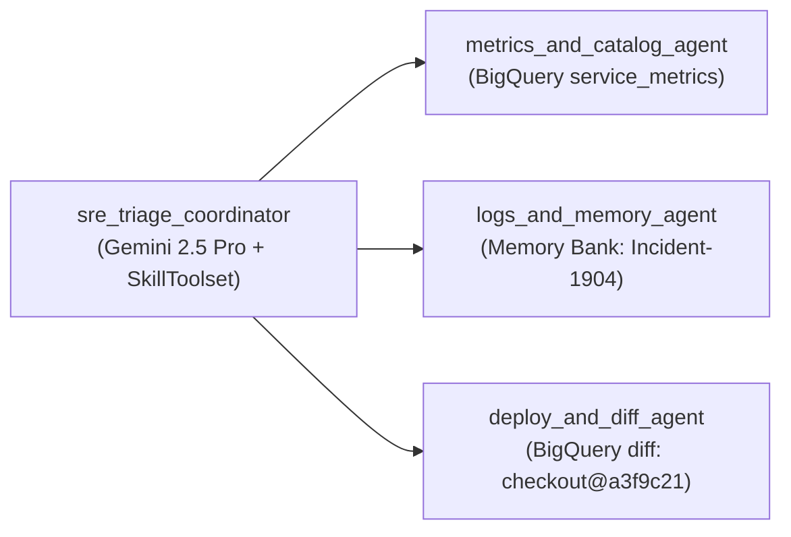

# Lab 1: Multi-Agent Incident Triage (BigQuery, Skills & Memory Bank)

Triages **`Incident-2277`** by coordinating 3 specialist sub-agents (`metrics_and_catalog_agent`, `logs_and_memory_agent`, `deploy_and_diff_agent`), filtering the `14:15 UTC` `auth` red herring via **Vertex AI Memory Bank (`Incident-1904`)**, and pinpointing **`checkout@a3f9c21`** (`dep-9017`).

- **Previous**: [← 0. Prework](../prework/README.md) · **Next**: [2. Lab 2: Guardrails & Sandbox →](../lab2_guardrails_reflection_sandbox/README.md)
- **Code**: [`agent.py`](agent.py) (Starter) · [`agent_complete.py`](agent_complete.py) (Solution) · [`incident-triage-runbook/SKILL.md`](../skills/incident-triage-runbook/SKILL.md)

## Quick Run

```bash
python3 lab1_triage_agent/agent_complete.py \
  --project_id="${GOOGLE_CLOUD_PROJECT}" \
  --location=us-central1
```

<details>
<summary><b>🔍 Key Capabilities Covered (Click to Expand)</b></summary>

1. **Multi-Agent Hierarchy (`LlmAgent`)**: Root `sre_triage_coordinator` (`gemini-2.5-pro`) delegates high-volume log/metric queries to `gemini-2.5-flash` specialists.
2. **ADK `SkillToolset` (`L1 -> L2`)**: Loads `skills/incident-triage-runbook/SKILL.md` on demand.
3. **Cloud BigQuery (`BigQueryToolset`)**: Parameterized read-only queries against `service_metrics`, `app_logs`, `deployments`, and `commit_diffs`.
4. **Vertex AI Memory Bank (`VertexAiMemoryBankService`)**: Recalls `Incident-1904` so the agent skips rolling back `auth`.
</details>

<details>
<summary><b>🗺️ Lab 1 Architecture Diagram</b></summary>


</details>
