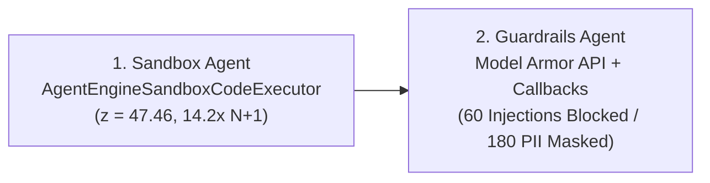

# Lab 2: Guardrails (Model Armor) & Vertex AI Code Sandbox

Proves the `checkout@a3f9c21` root cause mathematically inside an isolated **Code Sandbox (`z = 47.46`, `14.2x` N+1 SQL multiplier)** and blocks **60 prompt injections** + redacts **180 PII items** using **Google Cloud Model Armor** and ADK callbacks.

- **Previous**: [← 1. Lab 1: Triage](../lab1_triage_agent/README.md) · **Next**: [3. Lab 3: Agent Evaluation (Eval) →](../lab3_council_agent/README.md)
- **Code**: [`agent.py`](agent.py) (Starter) · [`agent_complete.py`](agent_complete.py) (Solution) · [`model_armor_template.yaml`](../policies/model_armor_template.yaml)

## Quick Run

```bash
python3 lab2_guardrails_reflection_sandbox/agent_complete.py \
  --project_id="${GOOGLE_CLOUD_PROJECT}" \
  --location=us-central1
```

<details>
<summary><b>🛡️ Key Capabilities Covered (Click to Expand)</b></summary>

1. **Vertex AI Code Sandbox (`AgentEngineSandboxCodeExecutor`)**: Computes pre-deploy (`182.4ms`) vs. post-deploy (`2,418.7ms`) `p99` latency (`z = 47.46`) and verifies the N+1 `OrderItem.objects.get` loop.
2. **ADK Guardrail Callbacks (`before_model_callback` & `before_tool_callback`)**: Calls Google Cloud Model Armor (`:sanitizeUserPrompt`) to block direct prompt injections and enforce service allow-lists.
3. **Log Sanitization (`ModelArmorInspector`)**: Neutralizes 60 indirect prompt-injection payloads in `app_logs` and masks 180 customer emails/payment tokens.
</details>

<details>
<summary><b>🗺️ Lab 2 Architecture Diagram</b></summary>


</details>
