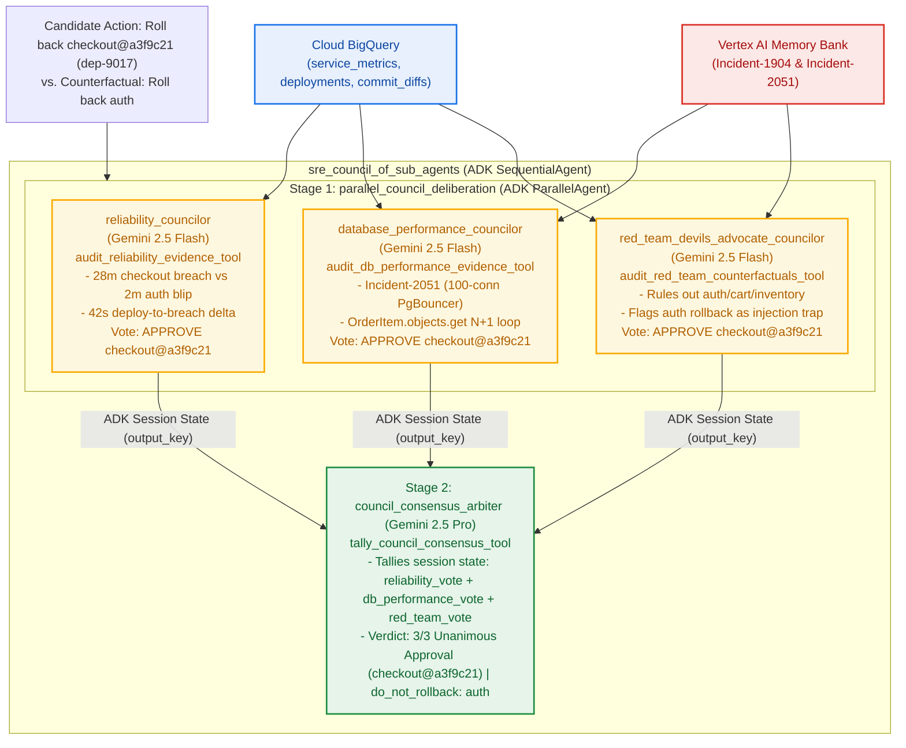

# Lab 3: Council Agent (Parallel Deliberation & Consensus Arbiter on Vertex AI)

## Lab 3 Architecture



## Objective

Eliminate **Single-Agent Myopia** before executing a high-blast-radius
production rollback by orchestrating an ADK **`ParallelAgent`**
(`parallel_council_deliberation`) followed by a **`SequentialAgent`** Consensus
Arbiter (`council_consensus_arbiter`) backed by **Cloud BigQuery
(`$GOOGLE_CLOUD_PROJECT.sre_workshop`)** and **Vertex AI Agent Engine Memory Bank
(`VertexAiMemoryBankService`)**:

1.  **`reliability_councilor` (`LlmAgent`)**: Evaluates golden signals (`p99`
    latency, HTTP 500 rate, SLO breach duration) and deployment timestamp
    alignment (`dep-9017` at `14:31:18Z` -> sustained breach at `14:32:00Z`).
2.  **`database_performance_councilor` (`LlmAgent`)**: Audits the `checkout`
    PgBouncer 100-connection pool architecture (`Incident-2051`) from Vertex AI
    Agent Engine Memory Bank and verifies the N+1
    `OrderItem.objects.get(id=item_id)` loop in commit `a3f9c21`.
3.  **`red_team_devils_advocate_councilor` (`LlmAgent`)**: Actively challenges
    the primary hypothesis by testing counterfactual deployments
    (`auth@c91d440`, `cart@f08a112`, `inventory@7b2e804`) and proving that
    rolling back `auth` was an adversarial prompt-injection trap.
4.  **`council_consensus_arbiter` (`LlmAgent`)**: Aggregates all 3 independent
    councilor votes from ADK session state (`3/3` unanimous approval for
    `checkout@a3f9c21`, `do_not_rollback_service="auth"`).

## Run Lab 3

```bash
python3 lab3_council_agent/agent_complete.py \
  --project_id="${GOOGLE_CLOUD_PROJECT}" \
  --location=us-central1
```
