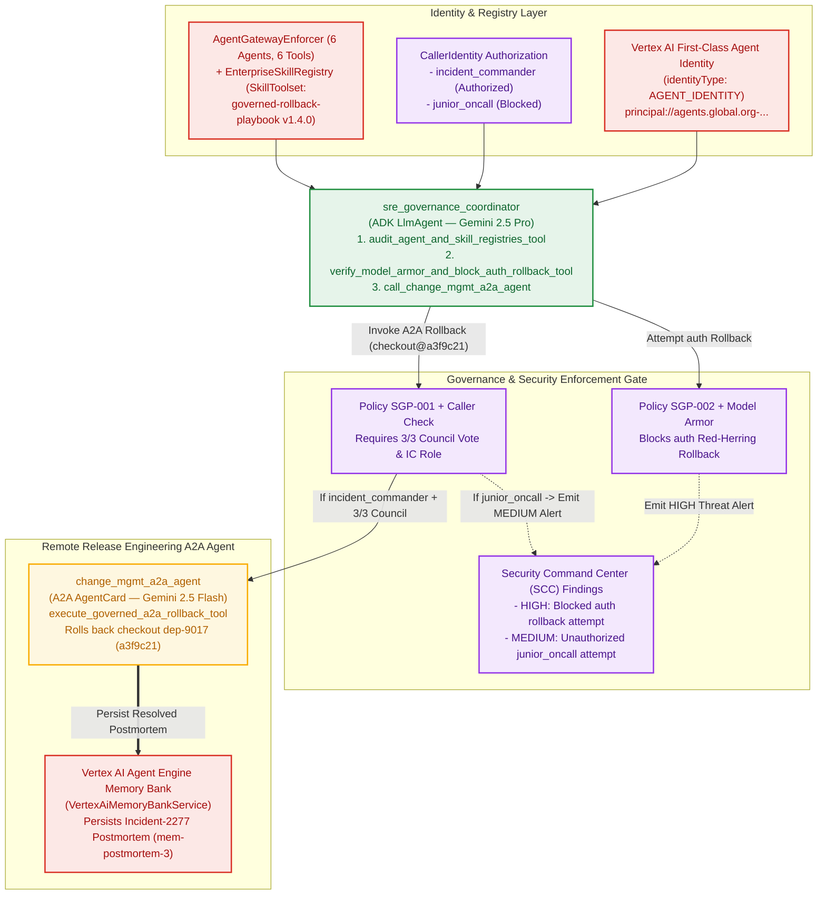

# Lab 4: Agent Identity, Skill Registry, Model Armor, A2A Card & Cross-Agent Execution

## Lab 4 Architecture



## Objective

Govern the SRE Guardian fleet on **Vertex AI Agent Engine** and execute the
production rollback call **from one ADK agent (`sre_governance_coordinator`) to
another remote A2A agent (`change_mgmt_a2a_agent`)**:

1.  **Vertex AI First-Class Agent Identity (`identityType: AGENT_IDENTITY`) &
    Fleet Inventory (`AgentGatewayEnforcer.register_fleet`)**: Verifies the
    provisioned `principal://agents.global.org-...` identity on Vertex AI Agent
    Engine and inventories all 6 workshop agents (`sre_triage_coordinator`,
    `metrics_and_catalog_agent`, `logs_and_memory_agent`,
    `sre_council_of_sub_agents`, `sre_governance_coordinator`,
    `change_mgmt_a2a_agent`) and 6 authorized MCP/A2A tool endpoints.
2.  **Skill Registry
    (`EnterpriseSkillRegistry(google.adk.skills.SkillRegistry)`)**: Registers,
    validates, and version-pins `incident-triage-runbook` (`v2.1.0`) and
    `governed-rollback-playbook` (`v1.4.0`), exposing them to
    `sre_governance_coordinator` via ADK's `SkillToolset`.
3.  **Caller Identity & Policy Enforcement (`CallerIdentity`)**: Evaluates
    caller authorization before high-blast-radius mutations:
    -   `junior_oncall` (`roles/sre.juniorOncall`) is **blocked**
        (`BLOCKED_BY_OBO_IDENTITY`).
    -   `incident_commander` (`roles/sre.incidentCommander`) is **authorized**
        (`EXECUTED_VIA_A2A_CHANGE_MGMT_AGENT`).
4.  **Google Cloud Model Armor (`ModelArmorInspector` / `sre-guardian-armor-policy`)
    & Semantic Governance Policies**: Blocks indirect prompt injections
    attempting to roll back `auth` (`SGP-002-PROTECT-AUTH-RED-HERRING`) and
    redacts synthetic SDP PII tokens/emails.
5.  **Security Audit & Threat Detection (`scc_threat_findings`)**:
    Emits structured `HIGH` and `MEDIUM` severity security findings whenever a
    blocked `auth` rollback attempt or unauthorized rollback attempt is
    intercepted.
6.  **Execute Call from Another Agent & Persist to Vertex AI Memory Bank
    (`sre_governance_coordinator -> change_mgmt_a2a_agent`)**:
    `sre_governance_coordinator` invokes `call_change_mgmt_a2a_agent`
    (`SubAgentDispatchTool`) to execute the rollback in `change_mgmt_a2a_agent`
    and persist the resolved `Incident-2277` postmortem into **Vertex AI Agent
    Engine Memory Bank (`VertexAiMemoryBankService`)**.

## Run Lab 4

```bash
# Run as Incident Commander (authorized rollback via A2A):
python3 lab4_governance_and_a2a/agent_complete.py \
  --project_id="${GOOGLE_CLOUD_PROJECT}" \
  --location=us-central1 \
  --persona=incident_commander

# Run as Junior On-Call (blocked at the Agent Gateway):
python3 lab4_governance_and_a2a/agent_complete.py \
  --project_id="${GOOGLE_CLOUD_PROJECT}" \
  --location=us-central1 \
  --persona=junior_oncall
```
