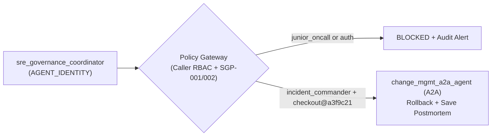

# Lab 4: Vertex AI Agent Identity (`AGENT_IDENTITY`) & A2A Rollback

Verifies **Vertex AI First-Class Agent Identity (`identityType: AGENT_IDENTITY`)**, enforces caller authorization (`incident_commander` vs. `junior_oncall`), executes the governed **A2A rollback** of `checkout@a3f9c21` via `change_mgmt_a2a_agent`, and persists the `Incident-2277` postmortem back to **Vertex AI Memory Bank**.

- **Previous**: [← 3. Lab 3: Agent Evaluation (Eval)](../lab3_council_agent/README.md) · **Back to**: [Root Workshop Guide](../README.md)
- **Code**: [`agent.py`](agent.py) (Starter) · [`agent_complete.py`](agent_complete.py) (Solution) · [`semantic_policy.yaml`](../policies/semantic_policy.yaml)

## Quick Run

```bash
# 1. Authorized execution as Incident Commander (executes A2A rollback):
python3 lab4_governance_and_a2a/agent_complete.py \
  --project_id="${GOOGLE_CLOUD_PROJECT}" \
  --persona=incident_commander

# 2. Unauthorized execution as Junior On-Call (blocked by policy):
python3 lab4_governance_and_a2a/agent_complete.py \
  --project_id="${GOOGLE_CLOUD_PROJECT}" \
  --persona=junior_oncall
```

<details>
<summary><b>🔐 Key Governance & Identity Checks (Click to Expand)</b></summary>

1. **First-Class Agent Identity (`AGENT_IDENTITY`)**: Verifies the `principal://agents.global.org-...` identity and IAM bindings (`roles/aiplatform.user`, `roles/bigquery.user`, `roles/modelarmor.user`).
2. **Caller RBAC & Policy Enforcement (`SGP-001` / `SGP-002`)**: Blocks `auth` red-herring rollbacks and blocks `junior_oncall` production mutations while allowing `incident_commander`.
3. **Cross-Agent A2A Rollback & Memory Persistence**: Calls `change_mgmt_a2a_agent` (`ReasoningEngine.spec.agentCard`) to roll back `checkout@a3f9c21` (`dep-9017`) and saves `mem-postmortem-3` (`Incident-2277`) in Vertex AI Memory Bank.
</details>

<details>
<summary><b>🗺️ Lab 4 Architecture Diagram</b></summary>


</details>
