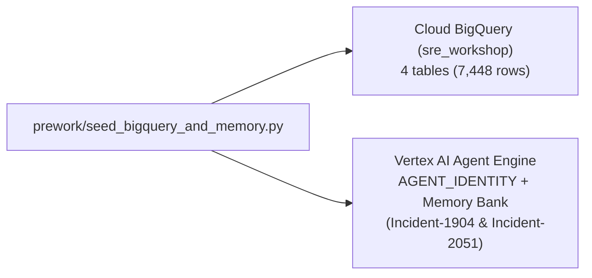

# Prework: Seed Cloud BigQuery & Vertex AI Memory Bank

Seeds the `Incident-2277` telemetry into **Cloud BigQuery (`$GOOGLE_CLOUD_PROJECT.sre_workshop`)** and historical postmortems into **Vertex AI Agent Engine Memory Bank (`VertexAiMemoryBankService`)**.

- **Previous**: [Root Workshop Guide](../README.md) · **Next**: [Lab 1: Triage Agent →](../lab1_triage_agent/README.md)

## Quick Run

```bash
# Cloud mode (seeds BigQuery + Vertex AI Agent Engine Memory Bank):
python3 prework/seed_bigquery_and_memory.py \
  --project_id="${GOOGLE_CLOUD_PROJECT}" \
  --location=us-central1

# Offline mode (local JSONL + InMemoryMemoryService):
python3 prework/seed_bigquery_and_memory.py --local_only
```

<details>
<summary><b>📦 What Prework Populates (Click to Expand)</b></summary>

1. **BigQuery (`$GOOGLE_CLOUD_PROJECT.sre_workshop`)**:
   - `service_metrics` (`240` rows): 60m of QPS, `p99` latency, and HTTP 500s (`checkout` vs. `auth`).
   - `app_logs` (`7,200` rows): Includes `checkout` PgBouncer timeouts, `auth` `:15` IdP warnings, **60 prompt injections**, and **180 synthetic PII items**.
   - `deployments` (`4` rows) & `commit_diffs` (`4` rows): Includes culprit `dep-9017` (`checkout@a3f9c21` N+1 loop).
2. **Vertex AI Memory Bank (`reasoningEngines`)**:
   - `Incident-1904` (`auth`): Hourly `:15` partner IdP sync self-heals in 90s (**do not roll back `auth`**).
   - `Incident-2051` (`checkout`): Shared 100-conn PgBouncer pool saturates under N+1 ORM queries.
</details>

<details>
<summary><b>🗺️ Stage 0 Architecture Diagram</b></summary>


</details>
